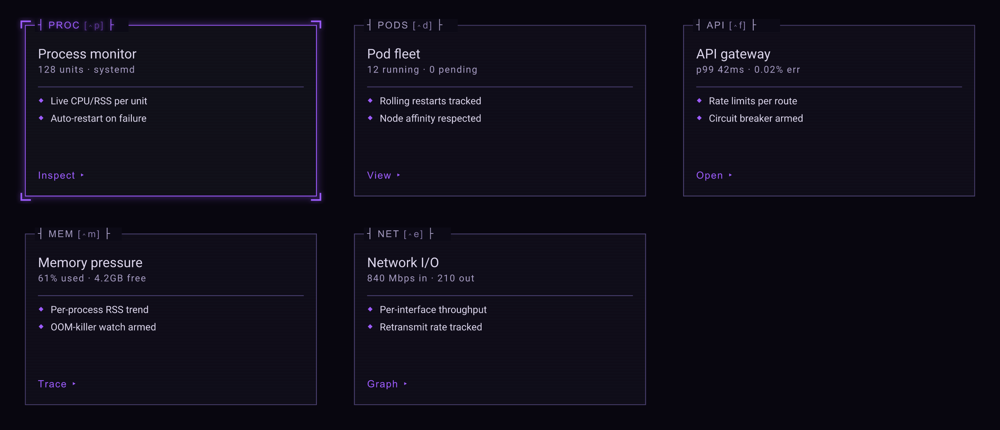

# tui-kit

For developers writing full-screen terminal apps in Rust (dashboards, workspaces,
consoles) who want them to look and behave consistently without building every widget
and rule themselves. tui-kit gives you:

- rules for how such a screen is laid out and coloured, and Rust widgets for
  [Ratatui](https://ratatui.rs) that follow them;
- cards shown as real images in terminals that can draw pictures;
- if you want to draw the screen with [Ink](https://github.com/vadimdemedes/ink) (React in
  the terminal) instead of Ratatui, the two halves that connect your Rust program to an
  Ink renderer running beside it.

Each part works on its own; take only what you need.



*The card gallery, `cargo run --example gallery`. The cards' contents are sample data.*

## What is here

| Part | Where | What it gives you |
|---|---|---|
| TUI Design | [`docs/tui/`](docs/tui/STYLE_GUIDE.md) | The rules for a screen: one layout, colours, keys and help, numbered (`TUI-L3`) so reviews can cite them |
| Design layer | `src/design/` | TUI Design in code for Ratatui: theme with colour tiers, app bar, panels, help bar, row selection |
| Image cards | `src/` (`Card`, `CardGrid`, `ConsoleShell`) | Cards drawn as SVG and shown as real images in Kitty, iTerm2 or Sixel terminals, half-blocks elsewhere |
| Renderer link | [`crates/tui-kit-ipc`](crates/tui-kit-ipc) | In your Rust program: starts the Ink renderer, sends it what to draw, restarts it if it crashes, and falls back to drawing in Rust |
| Ink side | [`ink/`](ink) (`tui-kit-ink`) | In your Ink app: the other end of that link. The two are used together |

## Try it

```sh
git clone https://github.com/temet-ai/tui-kit && cd tui-kit
cargo run --example gallery              # the cards above: arrows or hjkl move, q quits
cargo run --example console              # cards inside an app shell with tabs and a status bar
cargo run --example console -- --selftest
```

You need Rust 1.90 or later. The examples run in any terminal: Kitty, Ghostty, WezTerm and
iTerm2 show the cards as sharp images, and other terminals show them in coloured
half-block characters, coarser but recognisable. `--selftest` draws the console off-screen
and checks it, for a machine without a terminal.

## Using it

From another Rust project:

```toml
[dependencies]
tui-kit = { git = "https://github.com/temet-ai/tui-kit" }
tui-kit-ipc = { git = "https://github.com/temet-ai/tui-kit" }   # only for an Ink renderer
```

Take Ratatui through `tui_kit::ratatui` rather than your own dependency, so the types your
widgets draw into are the ones this crate was built against.

A screen with the design layer:

```rust
use tui_kit::design::{frame, AppBar, DesignTheme, FrameSpec, HelpBar, KeyHint, Panel, Tier};
use tui_kit::design::layout::nav_width_for;
use tui_kit::ratatui::{buffer::Buffer, layout::Rect, widgets::Widget};

let theme = DesignTheme::with_tier(Tier::detect());   // one theme, passed by reference
let area = Rect::new(0, 0, 80, 24);
let f = frame(area, FrameSpec::new(nav_width_for(["watch", "cases"])));
let mut buf = Buffer::empty(area);
AppBar::new(&["watch", "cases"], &theme).render(f.app_bar, &mut buf);
Panel::new("cases", &theme).focused(true).render(f.middle, &mut buf);
HelpBar::new(&[KeyHint::new("j/k", "move"), KeyHint::new("?", "help")], &theme).render(f.help_bar, &mut buf);
```

The same example, with the detail panel and row selection, is the documentation of
`src/design/mod.rs` (`cargo doc --open`, module `design`).

## Drawing with Ink instead

Your Rust program keeps all state. With `tui-kit-ipc` it starts your Ink app as a child
process, hands it the terminal, and sends it each screen as JSON over a Unix socket; the
Ink app, using `tui-kit-ink`, draws it and sends back what the user pressed. If the Ink
app keeps crashing or cannot start, your program is told and draws the same state with
Ratatui. It needs Node 22 or later and runs on macOS and Linux. Start with the Rust side's
[README](crates/tui-kit-ipc), then the [Ink side's](ink).

## How the parts stay separate

[docs/ARCHITECTURE.md](docs/ARCHITECTURE.md) says what each part owns, the lines between
them (the design layer and the image path never use each other; the renderer link knows
no renderer; the Ink side imports neither React nor Ink) and where new things go.
`tests/boundaries.rs` fails when a change crosses a line.

## Status

Early, and usable: the examples and tests pass, but there are no releases and the APIs will
change. Depend on the git repository and pin a commit if you need stability. Where a
widget in `src/design/` and the rules in `docs/tui/` disagree, the rules are right and the
widget is due a fix.

## Building and testing

```sh
cargo nextest run --workspace       # or cargo test
cd ink && npm install && npm test
```

`web-gallery/` runs the card gallery in a browser (WebAssembly); see its README.

## Licence

MIT ([LICENSE](LICENSE)). `src/render.rs` is adapted from Apache-2.0 code and stays under
that licence, as does the bundled Roboto font ([NOTICE](NOTICE)).
